# QA Link Cloud

The desktop companion to [dc-qalink](https://github.com/lamb2k/dc-qalink): link a Dreamcast (or Flycast) to your PC
and see live timings, grab the screen, push and run builds, send commands and keep sessions. Agents such as Claude
Code or Codex can drive the console through MCP.

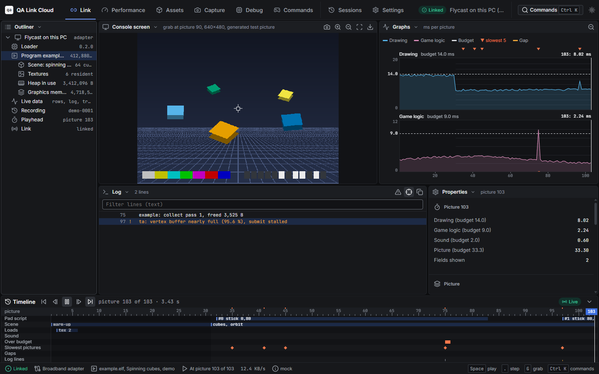
<sub>Link workspace, live against the mock bridge. Demo data (synthetic), not a measurement.</sub>

**Status: preview.** Works with Flycast. Run-and-return on a real console is still being fixed. Expect rough edges.

## What it does

- **Live timings:** per-picture phase times against your budget, the slowest pictures, gaps, counters and guards.
- **Screen grabs:** grab the console screen and compare two grabs side by side, as a difference or with a wipe.
- **Push and run:** send a build, run it, read its report and exit code. The bridge checks the build's hash.
- **Commands:** pause, step, reset, warp presets, test options, a virtual pad and pad scripts.
- **Sessions:** open, export and compare recorded sessions.
- **MCP for agents:** 23 tools (read, control, run code) for Claude Code, Codex or any MCP client.

## Requirements

- Windows 10 or 11, x64.
- No Python needed for the release zip: it brings its own (3.12, with numpy, Pillow and mcp). From source, the bridge
  runs with Python 3.10 or newer on PATH (`pip install mcp numpy pillow` for MCP and live assets).
- For a real console or Flycast: a **dc-qalink 0.2** checkout for the loader disc and example programs. Until 0.2.0 is
  released, use branch `v0.2` of https://github.com/lamb2k/dc-qalink.
- From source only: Node.js 22.

## Quick start

**From the release zip**
1. Download `QA-Link-Cloud-0.1.0-preview-win-x64.zip` from
   [Releases](https://github.com/lamb2k/dc-qalink-cloud/releases) and check it against `SHA256SUMS`.
2. Unzip anywhere and run `QA Link Cloud.exe`. It is portable and unsigned, so Windows SmartScreen may ask once.
3. The first run opens **Set up a console**. Skip it to explore the built-in demo session.

The zip carries dc-qalink's bridge (a pinned commit of `v0.2`, MIT) and its own Python in `resources\bridge`.

**From source**
```
git clone https://github.com/lamb2k/dc-qalink-cloud
cd dc-qalink-cloud
npm ci
npm run app          # build and open the desktop app
npm run dev          # or the web page at http://127.0.0.1:5178 (replays the demo session)
```
From source the app starts the mock bridge unless it finds dc-qalink: set `QALINK_DCQALINK` to your checkout.

## Setup flow

Seven steps: welcome, connection, loader disc, Flycast, find the console, first test, agents. Each step can be
skipped and is kept across restarts. Open it again from Settings or `Ctrl K` > "Set up a console".

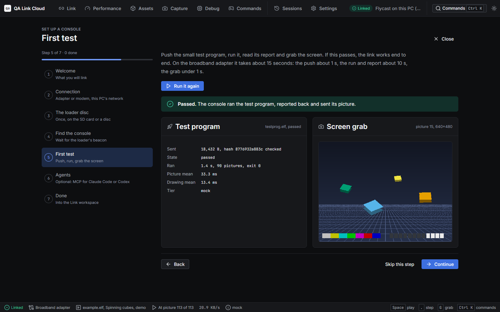
<sub>Setup flow, first test. Mock bridge, demo data (synthetic).</sub>

## Tour

The desktop app, dark theme, 1440x900, captured offscreen by the app's own test mode.

**Link.** The console screen, graphs, log, properties and one timeline with one playhead.
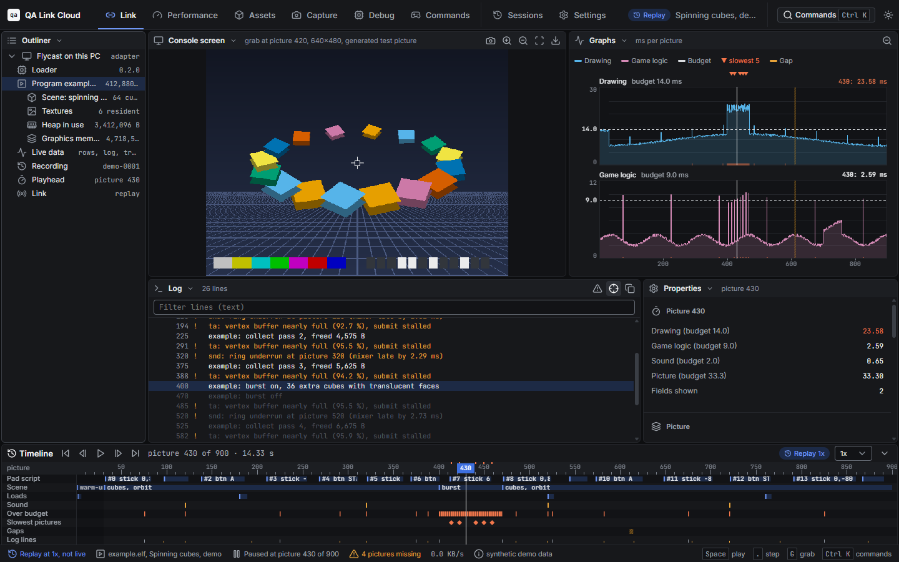
<sub>Replay of the demo session (synthetic).</sub>

**Performance.** Phase times per picture against budget, slowest pictures and counters.
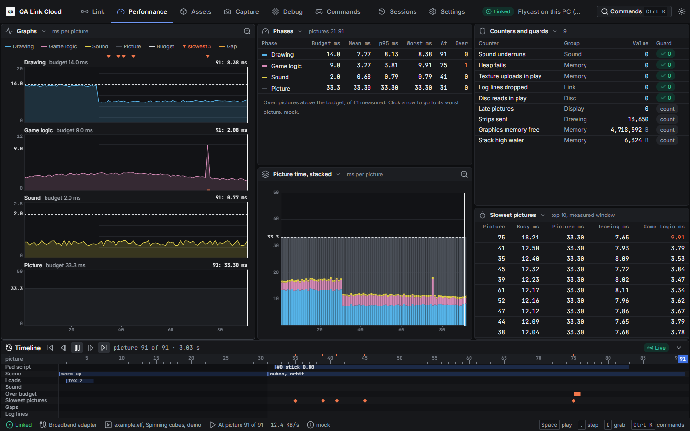
<sub>Live against the mock bridge. Demo data (synthetic).</sub>

**Capture.** Grab history and A/B compare: side by side, difference, wipe, pixel inspector.
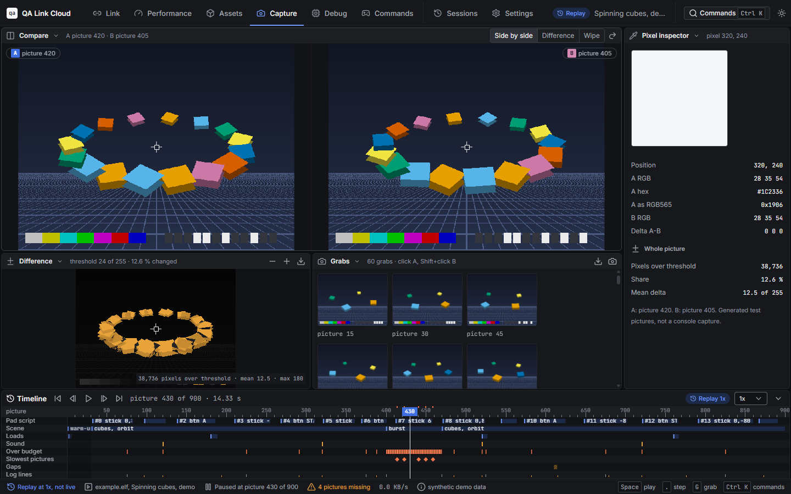
<sub>Replay of the demo session (synthetic).</sub>

**Assets.** Textures and models on disk beside what the console holds. The console side is a labelled mock for now.
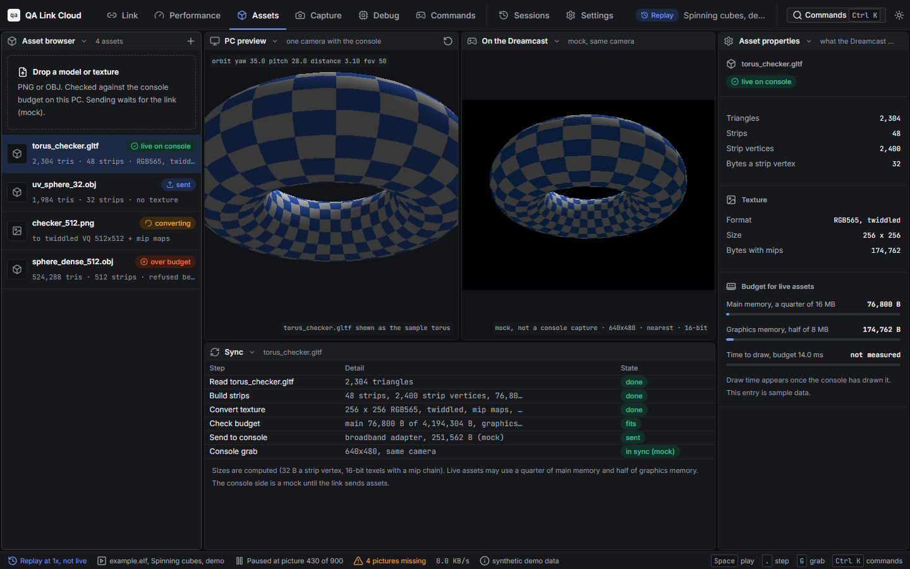
<sub>Replay of the demo session (synthetic).</sub>

**Debug.** Runs, run reports, memory and watched values.
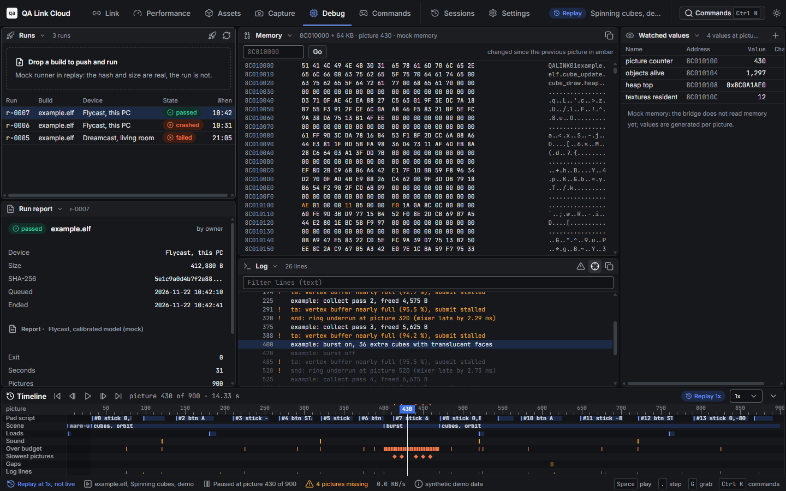
<sub>Replay of the demo session (synthetic).</sub>

**Commands.** Warp presets, console control, test options, a virtual pad and pad scripts.
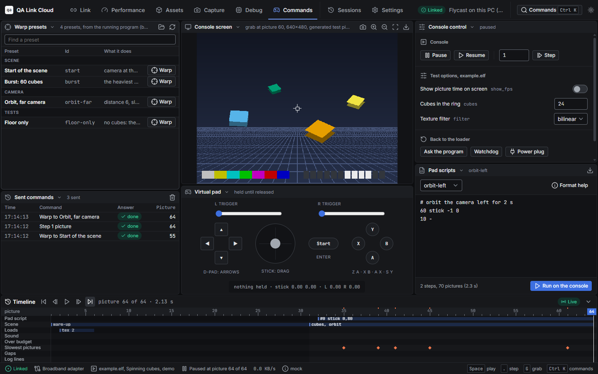
<sub>Live against the mock bridge. Demo data (synthetic).</sub>

**Sessions.** Recorded sessions; tick two to compare their phases side by side.
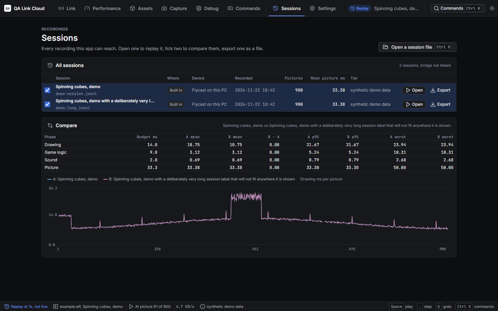
<sub>Two built-in demo sessions (synthetic).</sub>

**Settings.** Devices, the bridge and Flycast, the remote link (design only), agents, appearance.
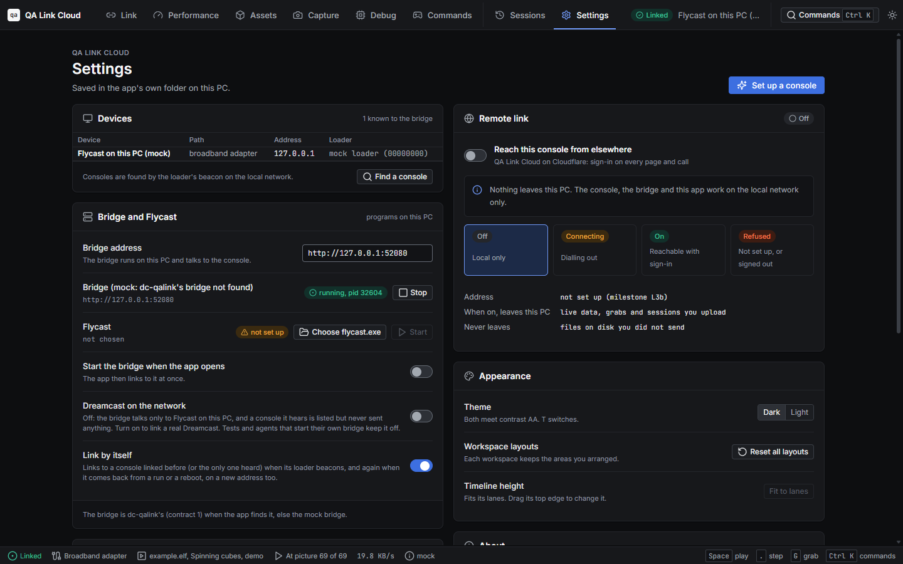
<sub>Live against the mock bridge. Demo data (synthetic).</sub>

**Agents (MCP).** Ready-to-paste lines for Claude Code and Codex.
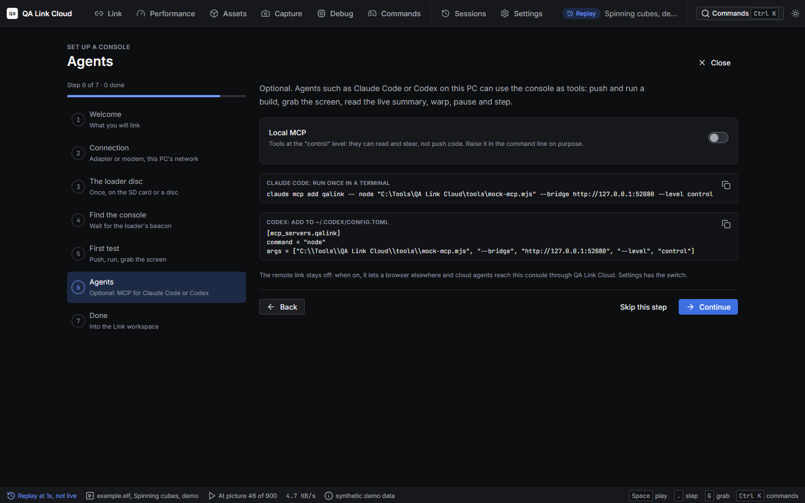
<sub>Setup flow, agents step. Example paths, demo data (synthetic).</sub>

## MCP for agents

Start the bridge first (Settings > Bridge and Flycast). Then, with the zip unzipped to `C:\Tools\QA Link Cloud`:

Claude Code:
```
claude mcp add qalink -- python -I "C:\Tools\QA Link Cloud\resources\bridge\pc\qalink_bridge.py" --mcp stdio --bridge http://127.0.0.1:52080 --mcp-level control
```
Codex (`~/.codex/config.toml`):
```
[mcp_servers.qalink]
command = "python"
args = ["-I", "C:\\Tools\\QA Link Cloud\\resources\\bridge\\pc\\qalink_bridge.py", "--mcp", "stdio", "--bridge", "http://127.0.0.1:52080", "--mcp-level", "control"]
```
The app shows these lines with your own paths in Settings > Agents. Level `control` can read and steer but not push
code; raise it to `run` on purpose. Tool list: [docs/MCP_TOOLS.md](docs/MCP_TOOLS.md).

## Safety

- **Local only by default.** The bridge's API listens on `127.0.0.1` only (it hears loader beacons on UDP 52060).
  The app loads nothing remote and connects only to itself and the bridge on this PC.
- **"Dreamcast on the network" is a person's choice.** It is off by default: the bridge then talks only to Flycast on
  this PC. Tests, scripts and agents that start their own bridge keep it off.
- **No firewall changes.** The app never edits Windows settings or your own Flycast settings.
- **The remote link is a design preview.** Turning it on connects to nothing.
- **Locked-down window:** context isolation, sandbox, strict content security policy, no navigation, no new windows.
  Details: [docs/DESKTOP.md](docs/DESKTOP.md).

## Keys

`Ctrl K` every command · `Space` play or pause · `.` / `,` step · `G` grab · `N` next picture over budget ·
`F` follow the newest picture · `T` theme · `1`-`6` workspaces, `7` Sessions, `8` Settings.

## Building

```
npm ci
npm run build        # token lint, type check, web build (dist/)
npm test             # unit tests; set QALINK_DCQALINK to a dc-qalink checkout to also test the real bridge
npm run app:dist     # portable app and zip in out/app (mock bridge only)
npm run app:dist -- --bridge <dc-qalink checkout> --bridge-ref <commit>   # with dc-qalink's bridge bundled
npm run app:capture  # test mode: renders offscreen, captures itself, exits (no window)
node tools/desktop-capture.mjs --set readme   # the pictures in this README
```
More: [docs/DESKTOP.md](docs/DESKTOP.md) (the desktop app), [docs/BRIDGE_API.md](docs/BRIDGE_API.md) (the bridge
contract), [docs/SESSION_FORMAT.md](docs/SESSION_FORMAT.md) (session files).

Web page options: `?ws=link|perf|assets|capture|debug|commands|sessions|settings`, `?theme=dark|light`,
`?src=replay|live`, `?bridge=<url>`, `?at=<picture>`, `?setup=<step>`, `?session=demo|long`.

## Licence

MIT, see [LICENSE](LICENSE). Fonts (SIL OFL 1.1), icons (ISC) and packages: [THIRD_PARTY_NOTICES.md](THIRD_PARTY_NOTICES.md).

Independent tool; not affiliated with Sega. The demo sessions are synthetic: generated by
`tools/make-demo-session.mjs` with a generated test picture, no game art.
